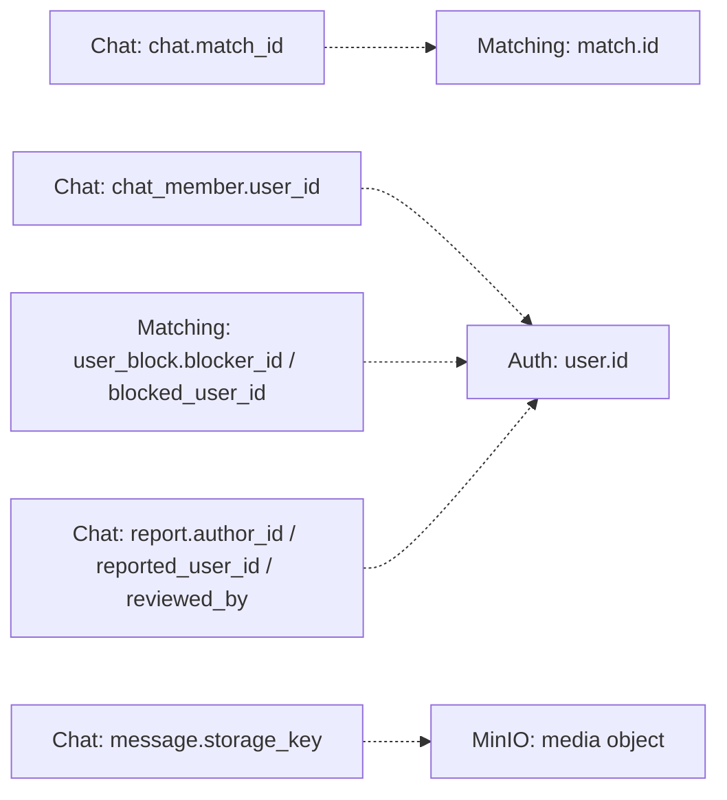

# ER-диаграмма Totally Swipes

Диаграмма отражает ограничения SQL из [миграций](../migrations/). Назначение полей и бизнес-правила описаны в [relations.md](relations.md).

`||` — ровно одна запись, `o|` — ноль или одна, `o{` — ноль или много. `PK` — первичный ключ, `FK` — внешний ключ, `UK` — уникальный ключ. Комментарии `U1` обозначают поля одного составного уникального ключа внутри таблицы.

У пользователя может быть **0..1 анкета**, у каждой анкеты — ровно один пользователь. `UNIQUE (profile.user_id)` сохраняется. Backend при регистрации создаёт пользователя и анкету в одной транзакции. Профиль без версий SQL также допускает, поэтому связь с `profile_version` показана как `0..N`.

Теги связаны с `profile_version` через `profile_tag.profile_version_id`. Каждая версия имеет собственный набор тегов, включая пустой; составной первичный ключ — `(profile_version_id, tag_id)`. Прямой связи `profile_tag` с `profile` нет.

Фотографии и свайпы связаны с `profile`. Новая версия анкеты не требует переноса свайпов; версия анкеты на момент действия не фиксируется. Исторические версии сохраняют поля анкеты и наборы тегов, но не состав фотографий.

`swipe` хранит текущее действие для пары `(author_id, target_profile_id)` — это составной первичный ключ. Повторный свайп обновляет `action` и `updated_at`, сохраняя `created_at`; история действий не ведётся.

У пользователя может быть **0..1 запись местоположения**. `user_location.user_id` одновременно является первичным и внешним ключом. `coordinates` содержит одну точку PostGIS типа `geography(Point, 4326)`, `district` допускает `NULL`. Местоположение обновляется без сохранения истории. Пространственного индекса нет; расстояние планируется вычислять для уже выбранных анкет.

Ограничения, не выражаемые линиями ER-диаграммы:

- `swipe.action` допускает только `like`, `dislike`, `super_like`; временные поля конечны, `updated_at >= created_at`. Свайп собственной анкеты запрещает backend. Для создания матча backend блокирует обоих пользователей в порядке `id`, сохраняет свайп и проверяет взаимный интерес в одной транзакции `READ COMMITTED`.
- В `user_location` город не пустой после `btrim`, район либо `NULL`, либо не пустой после `btrim`; `created_at <= updated_at`. Удаление пользователя каскадно удаляет местоположение.
- `subscription_no_overlap` запрещает пересечение периодов `[starts_at, ends_at)` одного пользователя через `EXCLUDE USING gist`; соседние периоды разрешены. `CHECK` требует конечных границ и положительной длительности.
- Триггеры запрещают `UPDATE` строк `user_answer`, `profile_tag` и `profile_version`.
- `profile_psycho_no_rewrite` запрещает обновление готового результата и изменение идентификаторов и времени записи незавершённого. Пять показателей либо все `NULL`, либо все заполнены — это обеспечивает `CHECK`.
- Триггеры запрещают прямой `DELETE` строк `user_answer`, `profile_tag`, `profile_version` и `profile_psycho`. Каскадное удаление при удалении владельца сохраняется. Добавление связей к старым версиям и ответов к готовым результатам пока не запрещено.

`profile_psycho.personality_type` хранит тип, показанный после теста. Допустим `NULL`; непустое значение требует заполненных показателей и защищено от изменения вместе с готовым результатом.

```mermaid
erDiagram
    user {
        bigint id PK
        text email UK
        text password_hash
        boolean is_disabled "DEFAULT false"
        timestamptz created_at
        timestamptz updated_at
    }

    profile {
        bigint id PK
        bigint user_id FK, UK
        timestamptz created_at
        timestamptz updated_at
    }

    profile_version {
        bigint id PK
        bigint profile_id FK, UK "U1"
        integer revision UK "U1"
        timestamptz recorded_at
        text name "NULL"
        date birth_date "NULL"
        text sex "NULL"
        text dating_goal "NULL"
        text about_me
        text education
        text work
        text smoking
        text alcohol
        smallint height
    }

    search_filter {
        bigint user_id PK, FK
        text sex
        smallint age_from
        smallint age_to
        timestamptz created_at
        timestamptz updated_at
    }

    profile_psycho {
        bigint id PK
        bigint profile_id FK, UK "U1"
        integer revision UK "U1"
        timestamptz recorded_at
        numeric openness
        numeric conscientiousness
        numeric extraversion
        numeric agreeableness
        numeric neuroticism
        text personality_type "NULL или один из 16 типов"
    }

    user_answer {
        bigint profile_psycho_id PK, FK
        smallint question_no PK "1..10"
        smallint answer_value
        timestamptz created_at
    }

    plan {
        bigint id PK
        text name UK
        boolean ads_enabled
        timestamptz created_at
        timestamptz updated_at
    }

    subscription {
        bigint id PK
        bigint user_id FK
        bigint plan_id FK
        timestamptz starts_at
        timestamptz ends_at
        timestamptz created_at
        timestamptz updated_at
    }

    tag {
        bigint id PK
        text name UK
        timestamptz created_at
        timestamptz updated_at
    }

    profile_tag {
        bigint profile_version_id PK, FK
        bigint tag_id PK, FK
        timestamptz created_at
    }

    report_type {
        bigint id PK
        text name UK
        timestamptz created_at
        timestamptz updated_at
    }

    report {
        bigint id PK
        bigint author_id "External Auth ID"
        bigint reported_user_id "External Auth ID"
        bigint report_type_id FK
        text body "Required for new rows"
        text status "pending, accepted, rejected"
        bigint reviewed_by "NULL or external Auth ID"
        timestamptz reviewed_at "NULL"
        timestamptz created_at
        timestamptz updated_at
    }

    photo {
        bigint id PK
        bigint profile_id FK, UK "U1"
        text storage_key UK
        smallint position UK "U1"
        timestamptz created_at
        timestamptz updated_at
    }

    photo_comment {
        bigint id PK
        bigint author_id FK
        bigint photo_id FK
        text body
        timestamptz created_at
        timestamptz updated_at
    }

    swipe {
        bigint author_id PK, FK
        bigint target_profile_id PK, FK
        text action "like, dislike, super_like"
        timestamptz created_at
        timestamptz updated_at
    }

    user_location {
        bigint user_id PK, FK
        text city
        text district "NULL"
        geography coordinates "Point, SRID 4326"
        timestamptz created_at
        timestamptz updated_at
    }

    match {
        bigint id PK
        bigint first_user_id FK, UK "U1"
        bigint second_user_id FK, UK "U1"
        boolean access_to_message
        timestamptz first_user_seen_at
        timestamptz second_user_seen_at
        timestamptz created_at
        timestamptz updated_at
    }

    chat {
        bigint id PK
        bigint match_id UK "External Matching ID, no FK"
        timestamptz created_at
    }
    chat_member {
        bigint chat_id PK, FK
        bigint user_id PK "External Auth ID"
        timestamptz seen_at "NULL"
        bigint last_read_seq "DEFAULT 0"
    }
    chat_sequence {
        bigint chat_id PK, FK
        bigint last_seq "DEFAULT 0"
    }
    message {
        bigint id PK
        bigint chat_id FK, UK "U1 seq; U2 sender and client ID; composite sender FK"
        bigint sender_id FK, UK "U2; NULL only for system; composite FK"
        bigint seq UK "U1"
        text client_message_id UK "U2; NULL allowed"
        text type "text, voice, video_note, system"
        text body "NULL for media"
        text storage_key "NULL for text and system"
        float duration_seconds "NULL for text and system"
        timestamptz edited_at "NULL"
        timestamptz deleted_at "NULL"
        bigint version
        timestamptz created_at
        timestamptz updated_at
    }
    user_block {
        bigint blocker_id PK "External Auth ID"
        bigint blocked_user_id PK "External Auth ID"
        timestamptz created_at
    }
    report_message {
        bigint report_id PK, FK
        bigint message_id PK, FK
    }

    user ||..o| profile : "user_id"
    user ||..o| search_filter : "user_id"
    profile ||..o{ profile_version : "profile_id"
    profile ||..o{ profile_psycho : "profile_id"
    profile_psycho ||--o{ user_answer : "profile_psycho_id"
    user ||..o{ subscription : "user_id"
    plan ||..o{ subscription : "plan_id"
    profile_version ||--o{ profile_tag : "profile_version_id"
    tag ||--o{ profile_tag : "tag_id"
    report_type ||..o{ report : "report_type_id"
    profile ||..o{ photo : "profile_id"
    user ||..o{ photo_comment : "author_id"
    photo ||..o{ photo_comment : "photo_id"
    user ||--o{ swipe : "author_id"
    profile ||--o{ swipe : "target_profile_id"
    user ||--o| user_location : "user_id"
    user ||..o{ match : "first_user_id"
    user ||..o{ match : "second_user_id"
    chat ||--o{ chat_member : "chat_id RESTRICT"
    chat ||--o| chat_sequence : "chat_id CASCADE"
    chat ||..o{ message : "chat_id RESTRICT"
    chat_member o|..o{ message : "chat_id + sender_id RESTRICT"
    report ||--o{ report_message : "report_id CASCADE"
    message ||--o{ report_message : "message_id RESTRICT"
```

## Логические ссылки между сервисами (не SQL FK)

Миграция `000008` намеренно не создаёт эти FK: удаление мэтча/аккаунта не должно каскадно стирать переписку и жалобы. В основной ER показаны только реальные SQL FK. У системного сообщения нет автора; составной FK сообщения проверяет пару `(chat_id, sender_id)`. Ровно двух участников и наличие счётчика для каждого чата обеспечивает backend, а SQL допускает их отсутствие. Текст и ключ удалённого сообщения остаются в БД; API скрывает содержимое. `user.is_disabled` — модераторский бан, `user_block` — отдельная блокировка пары.
